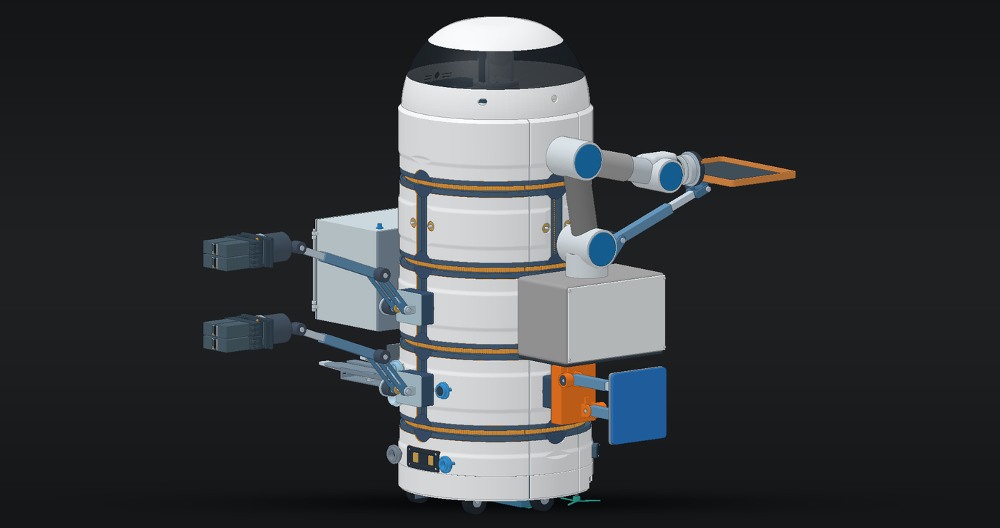
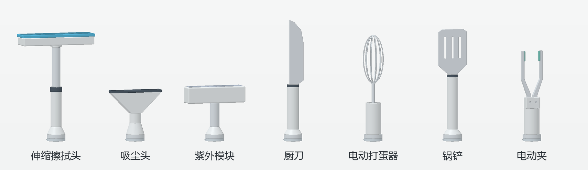
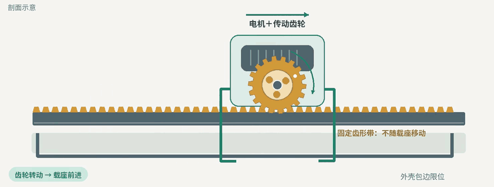

<h1 align="center">ATOM 原子家庭机器人</h1>

面向清洁与厨房作业的模块化家庭机器人

  <a href="docs/media/atom-tool-motion.mp4">观看原理动画 · 62 秒</a>
  &nbsp; · &nbsp;
  <a href="Atom_robot_assembly_v0.2.step">查看 CAD v0.2</a>

## 从一项家务出发

擦一张餐桌，擦拭头要贴住桌面，送出净水，再收回污水。搅拌一碗蛋液，需要的是一根能稳定旋转的搅拌轴。ATOM 从第一性原理出发，先看一项家务需要怎样的接触、动作和工具，再决定用哪些部件来完成它。

在这套设计里，每种插件承担明确的工作。擦拭头可以专门设计水路和接触面，电动夹可以专门设计夹爪行程和防滑垫。项目希望借此提高专门任务的完成质量，也让每项操作的安全性和稳定性能够分别验证。

这七种工具共用腕部接口，各自有对应的停放座。接口集成了供电、数据、净水、污水和干垃圾回收通道，每件工具按用途接入所需的通道。

## 机械臂的底座也能移动

底盘停在原地时，载座可以沿机身的环轨换工位，也可以沿竖轨调整工具高度。移动前，电磁铁拉回插销。载座上的电机驱动齿轮沿固定齿形带行走，到达工位后，弹簧将插销推入定位孔，机械臂再展开作业。

多载座布局服务于**并行家务**。例如，机身一侧的洗涤单元清洗餐具时，另一侧的载座可以把擦拭头送到桌边。这是 ATOM 希望实现的协作场景。完整动画还演示了竖向升降、机械臂收展，以及返回补给位补水和排污的过程。

## 先扫描家庭，再复用任务

ATOM 的智能系统设计参考 **Gemini notebookLM** 的使用思路。机器人先扫描家庭环境，记录房间布局、物体位置和可工作的区域，再把经常重复的操作整理成可调用的任务函数。

以“擦餐桌”为例，第一次建立任务时，可以记录餐桌的位置、高度和可擦拭范围，把工具选择、载座就位、擦拭和污水回收组织成一个流程。下次收到同样的指令，大模型可以调用已有流程，把判断集中在实际变化上，例如餐桌是否移动、桌面是否多了需要避开的杯子。

环境扫描、任务函数生成和并行调度是控制系统的设计目标。当前可审阅的成果是机械 CAD 与结构原理动画。

## 外壳与设计文件

首图展示原始总装加装白色外壳后的正常工作姿态。**360° 烟灰色眼窗**是一个连续的环形实体。五层机身侧盖沿原有分缝分件，给载座、导轨和插销留出活动空间。机身盖板主面与底护板厚 **3.0 mm**，头壳和眼窗厚 **3.2 mm**。

| 设计资料 | 用途 |
| --- | --- |
| [机器人总装 v0.2](Atom_robot_assembly_v0.2.step) | 查看更新后的机械总装 |
| [初始 CAD](ATOM_initial%20commit.step) | 对照项目首次提交的设计 |
| [工具移动原理动画](docs/media/atom-tool-motion.mp4) | 查看载座行走、锁定、作业与补给的顺序 |

本项目采用 [PolyForm Noncommercial 1.0.0 许可证](LICENSE)。
